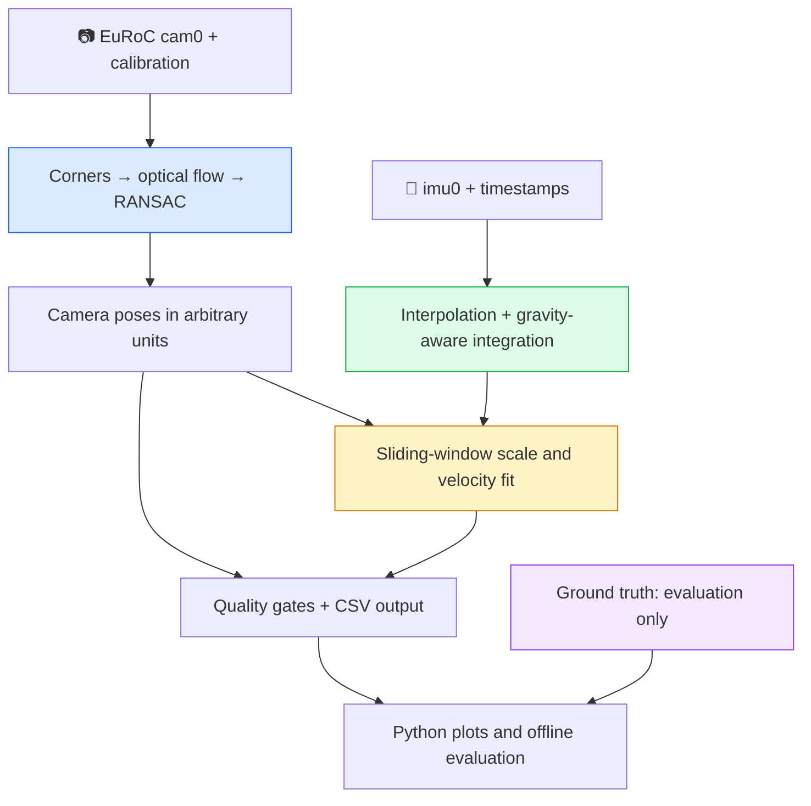
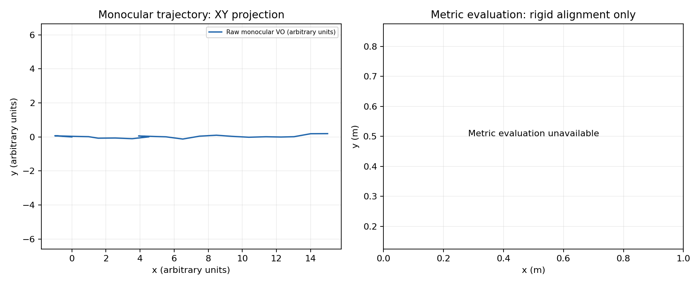

# VIO-Lite
### Camera and IMU-Based Motion Estimation

A compact C++17 command-line project for studying camera motion, sensor timing and the limits of a simple inertial scale experiment. It makes the intermediate decisions visible: tracked features, inliers, parallax, rejected windows and missing metric results all appear in the CSV output.

**Educational prototype. EuRoC MH_01_easy has not been executed in this delivery. Metric scale recovery and navigation accuracy are unverified.** See [RESULTS.csv](RESULTS.csv) and [verification evidence](evidence/VERIFICATION.md) for the actual checks performed.

## Why build this?

A camera can tell that a scene moved left between two images, but a single camera cannot tell whether that movement represents centimetres or metres. An IMU adds angular velocity and specific force. In principle, acceleration can help determine translation scale; in practice, gravity errors, bias and weak motion often dominate. This project implements the straightforward pipeline and reports where those assumptions fail.

It reads EuRoC's left camera, IMU and calibration, estimates relative camera motion, integrates IMU measurements and tries a small least-squares scale fit. There is no map, loop closure, bundle adjustment, EKF, ROS, GPU code or custom triangulation module. OpenCV's `recoverPose` internally uses a cheirality check; its internal points are not retained or used for mapping.

## Architecture



| Location | Responsibility |
|---|---|
| `src/dataset.cpp` | Strict CSV input, integer timestamps, sorting, duplicates, calibration and interval interpolation |
| `src/vision.cpp` | Corner detection, forward/backward LK, undistortion, essential matrix, pose recovery |
| `src/imu.cpp` | Quiet-prefix initialization, bias subtraction, midpoint integration |
| `src/scale.cpp` | Joint scale/initial-velocity least squares, observability and residual checks |
| `src/main.cpp`, `src/output.cpp` | CLI, window coordination, validity flags, timing and output |
| `scripts/evaluate.py` | Timestamp association, camera-centre ground truth, rigid alignment and plotting |
| `tests/` | Deterministic C++ numerical, parsing and vision cases |

## Installation

Linux / Ubuntu 24.04 is the verified host family. Windows execution is **not verified**; WSL2 Ubuntu is the simplest Windows route. Native Windows needs a C++17 compiler, OpenCV, Eigen and their CMake package paths. The Python launcher handles Visual Studio Release executable layout, but that route has not been tested.

```bash
sudo apt-get update
sudo apt-get install -y g++ cmake libopencv-dev libeigen3-dev python3-venv
python3 -m venv .venv
source .venv/bin/activate
python -m pip install -r scripts/requirements.txt
cmake -S . -B build -DCMAKE_BUILD_TYPE=Release
cmake --build build -j2
ctest --test-dir build --output-on-failure
python scripts/test_evaluation.py -v
```

The core uses C++17, OpenCV 4, Eigen 3, CMake and CTest. Python is used only for preparation, evaluation and plots. No API keys are needed; `.env.example` documents this.

For a complete synthetic smoke demonstration after installing dependencies:

```bash
python scripts/run_project.py --output output-smoke
```

The launcher builds, runs tests, creates a temporary **synthetic** EuRoC-shaped fixture, runs the C++ application and saves a plot. It is not recorded sensor data and cannot establish EuRoC accuracy. On an existing build, pass `--skip-build`.

## EuRoC MH_01_easy setup

1. Open the [official EuRoC page](https://projects.asl.ethz.ch/datasets/euroc-mav/).
2. Follow its **ETH Research Collection** download link, DOI [10.3929/ethz-b-000690084](https://doi.org/10.3929/ethz-b-000690084).
3. Choose the **MH_01_easy ASL-format image/IMU ZIP**, rather than the ROS bag. Download and extract it locally. If the collection offers individual files, obtain cam0, imu0, their `sensor.yaml` files and `state_groundtruth_estimate0` for evaluation.
4. Locate the directory named `mav0` under the extracted sequence. Pass that directory to `--dataset`; no dataset is bundled here.

The official page now directs downloads to the research collection. The old robotics.ethz.ch ZIP endpoint returned HTTP 503 during this build; the collection DOI returned 403 through the browsing service. Dataset bytes were unavailable. No successful download or EuRoC inference run is claimed.

Expected placement:

```text
datasets/MH_01_easy/mav0/
  cam0/sensor.yaml
  cam0/data.csv
  cam0/data/<timestamp>.png
  imu0/sensor.yaml
  imu0/data.csv
  state_groundtruth_estimate0/data.csv  # optional; evaluator only
```

Run from the project directory:

```bash
python scripts/run_project.py \
  --dataset datasets/MH_01_easy/mav0 \
  --output output-euroc --max-frames 300
```

Or run the stages separately:

```bash
./build/vio_lite --dataset datasets/MH_01_easy/mav0 \
  --config config/default.yaml --output output-euroc \
  --start-frame 0 --max-frames 300
python scripts/evaluate.py --run output-euroc --dataset datasets/MH_01_easy/mav0
# Optional shape diagnostic, explicitly fits scale from ground truth:
python scripts/evaluate.py --run output-euroc --dataset datasets/MH_01_easy/mav0 --sim3
```

`--start-frame` is a zero-based index in sorted image timestamps. Initialization consumes 0.5 seconds starting there, then estimation begins with the first image at or after that prefix. `--max-frames` counts output poses including the origin; each subsequent pose is a frame-pair attempt. It must be at least two. A small frame range reduces processing, but the strict loader still validates every listed image path and reads all IMU CSV records. To avoid downloading the full dataset, prepare a consistent local subset of both streams and their calibration files; changing only `--max-frames` does not reduce download size.

## What happens internally?

### 1. Synchronize without losing timestamp precision

Timestamps are signed 64-bit nanoseconds; only differences are converted to seconds. CSV rows are sorted, duplicate stamps and nonfinite numbers are rejected, and missing images cause a clear error. Each image interval gets interpolated IMU samples at both endpoints and all interior samples. A source IMU gap greater than 20 ms is rejected, even if the requested interval falls inside that gap. There is no extrapolation.

### 2. Track the camera

Each image pair detects up to 1,200 corners in the first image. Pyramidal Lucas–Kanade tracks them forward and backward. A point must stay in the image and return within one pixel of its origin. Coordinates are undistorted with the provided radtan coefficients. RANSAC fits an essential matrix in normalized coordinates; `recoverPose` chooses the relative rotation and unit translation direction. Its cheirality distance cutoff is 1,000 arbitrary baseline units (rather than the default 50), with the separate angular-parallax gate controlling small baselines.

At least 20 matches and 20 cheirality inliers, an inlier ratio of at least 35%, finite rigid transforms and at least one pixel of **rotation-compensated angular disparity** are required. A low-baseline or textureless pair produces a failure status. Relative image rotation is not blindly counted as translational parallax.

OpenCV returns `X_current = R_21 X_previous + t_21`. Camera-to-world accumulation uses `R_WC,new = R_WC,old R_21ᵀ` and `p_WC,new = p_WC,old − R_WC,new t_21`. Every successful translation has length one in arbitrary visual units. **This does not recover relative translation magnitudes across frames.** Consequently a single scale for a changing-speed path may be invalid. This deliberately simple baseline is an experiment, not a complete monocular VO/VIO estimator.

### 3. Put the IMU in the right frame

`T_BS` in cam0 calibration maps camera coordinates into the body frame: `p_B = R_BC p_C + t_BC`. The program checks imu0's `T_BS` and requires identity, as expected by this EuRoC-specific prototype. It refuses nonidentity body/IMU extrinsics rather than silently ignoring them.

The 0.5-second prefix is accepted only if acceleration standard deviation ≤0.15 m/s², gyro standard deviation ≤0.02 rad/s, mean corrected gyro norm ≤0.1 rad/s and corrected acceleration magnitude is within 0.35 m/s² of 9.81. At least 30 samples are required. The mean accelerometer direction establishes roll/pitch; yaw is arbitrary. The mean gyro is used as a constant bias. Configured accelerometer bias is subtracted; no accelerometer bias is learned.

These tests **assume** a stationary prefix. Quiet constant acceleration or very slow rotation can pass, so this is not proof of correct initialization. If initialization is rejected, camera VO still runs and metric output remains unavailable.

Midpoint gyro integration updates body-to-world orientation. Midpoint acceleration is rotated into world coordinates, then `(0,0,-9.81)` m/s² is added to remove gravity. Position and velocity are integrated. Initial velocity is set to zero for this integration, but is an unknown fitted parameter in each scale window. Windows subtract the accumulated starting velocity, which prevents arbitrary earlier integration velocity from directly deciding scale.

### 4. Ask whether scale is observable

For each 20-pose window, with times relative to its first pose:

`scale × visual_displacement_i − initial_velocity × time_i = acceleration_integral_i + camera_lever_displacement_i`

The camera lever term is `(R_WB,i − R_WB,0) t_BC`. This makes camera displacement and IMU displacement refer to the correct physical origins. Four unknowns are fitted with Eigen SVD: one scale and three components of initial velocity. Ground truth is never opened by the C++ estimator.

A window needs nonlinear-in-time visual displacement; constant-velocity straight motion cannot separate scale from initial velocity. The implementation projects visual displacement away from time to check that excitation, checks SVD conditioning, removes gross residual outliers once, and refits. It requires at least six retained samples and 70% retention, scale in `(0,100]`, relative residual ≤0.35 and adequate visual/gyro rotation agreement (<0.15 rad per pair). See config for adjustable window, excitation and residual thresholds.

**Numerical example:** for visual displacement `q(t) = (0.4t², 0.03t³, 0)` and true scale 2.5, construct acceleration-only displacement `d(t) = 2.5q(t) − (0.3,−0.2,0.1)t − lever(t)`. Fitting recovers scale 2.5 and that unknown velocity in the deterministic test. This is a constructed numerical check, not a measured sensor result. One injected large outlier is also tested.

After the run, at least three accepted windows are needed. Their median scale is applied retrospectively to the raw trajectory only if relative median absolute deviation ≤0.25, IMU processing remains valid and no image-pair failure occurred. Overlapping windows are correlated. These gates do not certify metric accuracy. A visual gap permanently marks the accumulated trajectory disconnected; subsequent local attempts and scale diagnostics may continue, but global metric coordinates stay blank.

## Output and evaluation

| File | Meaning |
|---|---|
| `trajectory.csv` | Nanosecond timestamps, raw position, optional metric position, tracking/connection flags, inliers, parallax, pair runtime, scale and rejection status |
| `run_summary.csv` | Processed poses, tracked/failed pairs, accepted scale windows, elapsed processing time, FPS, initialization and metric status |
| `RESULTS.csv` | Evaluator summary, associated poses and metric ATE when available; absent values are empty cells |
| `trajectory.png` | Separate raw-VO and metric-evaluation panels, so arbitrary units are not confused with metres |
| `sim3_shape.png` | Only with `--sim3` and valid geometry: shape diagnostic with scale fitted offline from ground truth |

Metric ATE is positional RMSE in metres after timestamp association and **rigid SE(3) alignment only**, never a fitted scale. Ground-truth body poses are transformed to camera centres with the supplied lever arm and ground-truth orientation. Camera centres are interpolated between ground-truth timestamps only across gaps ≤20 ms; timestamps remain integers during association. At least three associated positions with rank-two geometry are required to constrain alignment. Missing ground truth, insufficient geometry or unavailable metric positions produces an explicit status and empty error cells.

Timing covers image-pair loading, tracking, IMU work, scale fitting and in-loop bookkeeping. It excludes startup/loading CSVs, calibration, initialization, the first image and final CSV/plot writes. FPS is attempted image pairs divided by that elapsed wall time; it is not end-to-end application throughput. First-row pair runtime is zero because it is an origin, not an estimate. Runtime is environment-dependent.

## Verification

The recorded results and commands are in [evidence/VERIFICATION.md](evidence/VERIFICATION.md). Raw logs are included. The generated smoke plot below shows synthetic data only.



## Known limitations

- No relative translation magnitude estimation: unit-step VO makes one global scale unreliable under changing speed. Least-squares rejection is useful even when no metric result survives.
- Gravity/attitude errors, accelerometer bias, gyro noise and time offsets cause drift. Calibration is offline; sensor noise metadata is not used to weight this unweighted educational estimator.
- Quiet-prefix initialization assumes rest, known gravity magnitude and known accelerometer bias. It does not solve general moving initialization.
- Pure rotation, low parallax, repeated texture, lighting changes, blur and planar geometry can defeat essential-matrix estimation; current gates cannot detect every degeneracy.
- No trajectory repair after tracking loss, no loop closure and no long-term drift correction. Metric scale validity gates are heuristics, not confidence intervals.
- EuRoC execution, accuracy, full-sequence performance and Windows/MSVC operation remain unverified. Synthetic tests establish implementation behavior only.

## Troubleshooting

| Symptom | Action |
|---|---|
| CMake cannot find OpenCV or Eigen | Install development packages; for custom installs set `OpenCV_DIR` / `Eigen3_DIR` |
| `Cannot open cam0/data.csv` | Pass the `mav0` directory, not its parent |
| `Missing image` | Extract the camera images and keep CSV filenames unchanged |
| `IMU does not bracket timestamp` / synchronization gap | Obtain matching streams; avoid independently trimmed or incomplete CSVs |
| Initialization rejected | Select a known quiet prefix with `--start-frame`; do not use ground truth to initialize |
| Metric coordinates blank | Read `scale_status` and `metric_status`; insufficient excitation, tracking gaps or IMU inconsistency are legitimate experiment outcomes |
| Image resolution invalid | Use calibration from this exact camera stream and original-resolution images |
| No ATE despite a run | Supply ground truth to the evaluator and check association/geometry; do not replace metric ATE with Sim(3) error |

In restricted build environments, `VIO_OPENCV_PREFIX` supports headers and libraries extracted under one prefix. This optional CMake path was used for verification here; normal Ubuntu users should use the standard package configuration.

## References and license

- [EuRoC MAV dataset, ETH ASL](https://projects.asl.ethz.ch/datasets/euroc-mav/), Burri et al., 2016; [paper DOI](https://doi.org/10.1177/0278364915620033).
- [OpenCV calibration, essential matrix and pose recovery documentation](https://docs.opencv.org/4.x/d9/d0c/group__calib3d.html).
- [OpenCV optical-flow documentation](https://docs.opencv.org/4.x/dc/d6b/group__video__track.html).
- [Eigen SVD documentation](https://libeigen.gitlab.io/eigen/docs-nightly/group__SVD__Module.html).

Project code is MIT licensed; see [LICENSE](LICENSE). Dataset bytes and third-party libraries are not included and retain their own licensing terms.

## GitHub and CI

For Windows setup, GitHub upload and the scope of automatic CI checks, see [GITHUB_SETUP.md](GITHUB_SETUP.md). The workflow at `.github/workflows/ci.yml` is included but its first run on GitHub has **not** yet been observed.
